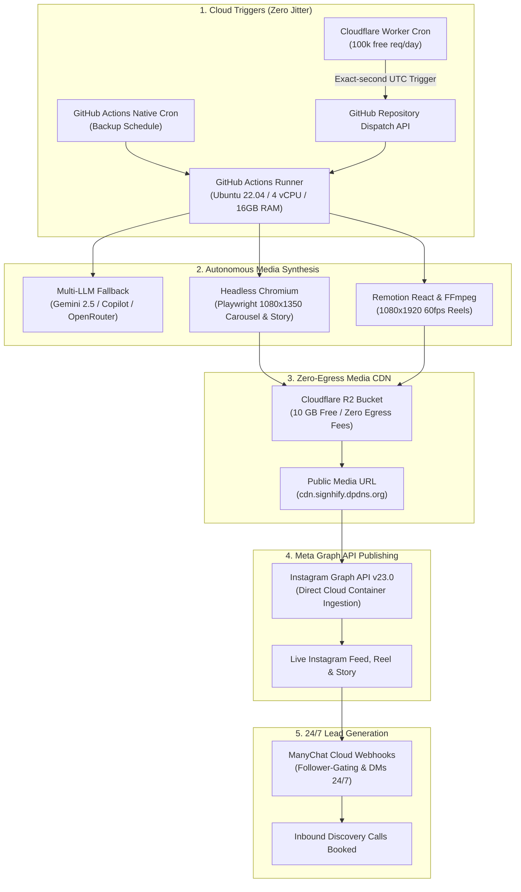

# ☁️ ZERO-PC CLOUD AUTOMATION ARCHITECTURE
## How to Run Autogram 24/7 in the Cloud for $0 Using Free Developer Infrastructure

> **Author:** Signhify Studio (`signhify.dpdns.org`)  
> **Engine:** Autogram Autonomous Publishing System  
> **Target:** 100% Zero-Touch 24/7 Instagram Carousel, Reel & Story Distribution  
> **Hardware Required:** $0 (No local computer or server required)

---

## 1. Architectural Blueprint: The Zero-Dollar Cloud Stack

To eliminate the need for keeping your local PC powered on, Autogram distributes its workload across six free, enterprise-grade cloud services:



---

## 2. The 5 Free Cloud Building Blocks

| Service | Free Tier Allowance | Role in Autogram | Cost |
|---|---|---|---|
| **GitHub Actions** | 2,000 Linux runner min/month (Private) / **Unlimited** (Public) | Executes pipeline, installs Playwright, renders carousel/reels, commits memory | **$0.00** |
| **Cloudflare Workers** | 100,000 requests/day, 10ms CPU/request | Fires exact-time webhook triggers to eliminate GitHub Actions cron delay | **$0.00** |
| **Cloudflare R2** | 10 GB storage/month, **$0 egress fees** | Hosts high-res JPEGs and MP4 reels so Meta Graph API can ingest them | **$0.00** |
| **Render.com** | 750 free instance hours/month | Hosts the Flask Dashboard (`dashboard_api.py`) and emergency webhook receiver | **$0.00** |
| **ManyChat Cloud** | Free tier (up to 1,000 contacts) | Cloud-native comment listener & follow-gated DM auto-responder | **$0.00** |

---

## 3. GitHub Actions Master Workflow: `daily-autopilot.yml`

Create this workflow at `.github/workflows/daily-autopilot.yml`:

```yaml
name: Autogram 24/7 Cloud Autopilot

on:
  schedule:
    # 4 Daily Slots aligned to Asia/Kolkata (IST = UTC + 5:30)
    - cron: '0 4 * * *'   # 09:30 AM IST (04:00 UTC) — Morning High-Signal Story
    - cron: '0 6 * * *'   # 11:30 AM IST (06:00 UTC) — Midday Prime Carousel
    - cron: '0 12 * * *'  # 05:30 PM IST (12:00 UTC) — Evening Tech Radar Story
    - cron: '0 14 * * *'  # 07:30 PM IST (14:00 UTC) — Evening Prime Reel / Carousel
  repository_dispatch:
    types: [publish-slot, trigger-autopilot]
  workflow_dispatch:
    inputs:
      slot:
        description: "Publishing Slot Format (carousel | reel | story)"
        required: true
        default: "carousel"
        type: choice
        options:
          - carousel
          - reel
          - story

jobs:
  autopilot:
    runs-on: ubuntu-latest
    timeout-minutes: 25
    permissions:
      contents: write

    steps:
      - name: 1. Checkout Repository
        uses: actions/checkout@v4
        with:
          fetch-depth: 0

      - name: 2. Set Up Python 3.12
        uses: actions/setup-python@v5
        with:
          python-version: "3.12"
          cache: "pip"

      - name: 3. Install Core Python Dependencies
        run: |
          python -m pip install --upgrade pip
          pip install -r requirements.txt

      - name: 4. Install Playwright Headless Chromium & System Fonts
        run: |
          playwright install --with-deps chromium
          sudo apt-get update && sudo apt-get install -y fonts-inter fonts-jetbrains-mono ffmpeg

      - name: 5. Setup Node.js (For Remotion Reels)
        uses: actions/setup-node@v4
        with:
          node-version: 20
          cache: "npm"
          cache-dependency-path: docs/reel-studio-kit/package.json

      - name: 6. Install Reel Studio Kit Dependencies
        run: |
          cd docs/reel-studio-kit
          npm ci

      - name: 7. Execute Autonomous Publishing Engine
        env:
          AUTOGRAM_OWNER_KEY: ${{ secrets.AUTOGRAM_OWNER_KEY || 'autogram_owner_vip_2026' }}
          GEMINI_API_KEY: ${{ secrets.GEMINI_API_KEY }}
          OPENROUTER_API_KEY: ${{ secrets.OPENROUTER_API_KEY }}
          CLOUDFLARE_API_TOKEN: ${{ secrets.CLOUDFLARE_API_TOKEN }}
          CLOUDFLARE_ACCOUNT_ID: ${{ secrets.CLOUDFLARE_ACCOUNT_ID }}
          CLOUDFLARE_R2_BUCKET: ${{ secrets.CLOUDFLARE_R2_BUCKET || 'autogram-media' }}
          IG_USER_ID: ${{ secrets.IG_USER_ID }}
          IG_ACCESS_TOKEN: ${{ secrets.IG_ACCESS_TOKEN }}
          META_API_VERSION: "v23.0"
          PUBLIC_CDN_BASE: ${{ secrets.PUBLIC_CDN_BASE || 'https://cdn.signhify.dpdns.org' }}
          DRY_RUN: 'false'
        run: |
          echo "Starting Autonomous Cloud Autopilot Run..."
          python orchestrator.py --run-all

      - name: 8. Persist Content Memory & Anti-Repetition Ledger
        if: always()
        run: |
          git config --global user.name "autogram-cloud-bot"
          git config --global user.email "bot@signhify.dpdns.org"
          git pull --rebase origin main || true
          git add data/content-memory.json data/schedule.json autopilot.db data/dm_automation_state.json || true
          git diff --cached --quiet || git commit -m "chore(cloud): update publishing memory and schedule ledger [skip ci]"
          git push origin main || echo "Memory sync completed without conflict."

      - name: 9. Upload Rendered Artifacts (Backup)
        if: always()
        uses: actions/upload-artifact@v4
        with:
          name: cloud-autopilot-deliverables
          path: output/
          retention-days: 30
```

---

## 4. Cloudflare Worker: Zero-Jitter Cron Dispatcher

GitHub Actions native cron schedules can occasionally experience delays (up to 15–20 minutes) during peak UTC hours. 

To ensure **second-level punctuality** for peak engagement slots (11:30 AM & 07:30 PM IST), deploy a single lightweight Cloudflare Worker with a Cron Trigger that dispatches GitHub's API:

```javascript
// Cloudflare Worker: autogram-cron-dispatcher
export default {
  async scheduled(event, env, ctx) {
    const GITHUB_REPO = "YourUsername/Autogram";
    const GITHUB_TOKEN = env.GH_PAT_TOKEN; // Personal Access Token with repo scope

    const response = await fetch(`https://api.github.com/repos/${GITHUB_REPO}/dispatches`, {
      method: "POST",
      headers: {
        "Accept": "application/vnd.github.v3+json",
        "Authorization": `Bearer ${GITHUB_TOKEN}`,
        "User-Agent": "Autogram-Cloudflare-Cron"
      },
      body: JSON.stringify({
        event_type: "publish-slot",
        client_payload: {
          timestamp: new Date().toISOString(),
          slot: event.cron
        }
      })
    });

    console.log(`Dispatched GitHub Actions Autopilot: HTTP ${response.status}`);
  }
};
```

---

## 5. Cloudflare R2: Free Public Media Storage

Meta's Graph API requires publicly reachable URLs to download carousel images and MP4 reels.

1. **Create Bucket:** In Cloudflare Dashboard, go to **R2** → Create Bucket `autogram-media`.
2. **Connect Custom Domain:** Connect `cdn.signhify.dpdns.org` (or use the free `*.r2.dev` public URL).
3. **Egress Advantage:** Unlike AWS S3 which charges $0.09/GB for data transfer, Cloudflare R2 has **$0 egress fees**, allowing Meta to fetch 4K and 1080p video containers without costing a dime.

In `src/storage/uploader.py`, Autogram already includes S3/R2 client support using standard `boto3`:
```python
import boto3

s3 = boto3.client(
    "s3",
    endpoint_url=f"https://{settings.cloudflare_account_id}.r2.cloudflarestorage.com",
    aws_access_key_id=settings.cloudflare_r2_access_key,
    aws_secret_access_key=settings.cloudflare_r2_secret_key,
)
```

---

## 6. Required GitHub Secrets Configuration

Add these secrets in **GitHub Repo → Settings → Secrets and variables → Actions**:

| Secret Key | Description | How to Get |
|---|---|---|
| `AUTOGRAM_OWNER_KEY` | Bypasses licensing gate | `autogram_owner_vip_2026` |
| `GEMINI_API_KEY` | Google Gemini API key | Google AI Studio (Free) |
| `OPENROUTER_API_KEY` | Multi-LLM fallback key | OpenRouter.ai |
| `IG_USER_ID` | Meta Instagram Business Account ID | Facebook Developer Portal |
| `IG_ACCESS_TOKEN` | 60-Day Long-Lived User Access Token | Facebook Graph API Explorer |
| `CLOUDFLARE_API_TOKEN` | Cloudflare R2 API token | Cloudflare Dashboard → R2 |
| `CLOUDFLARE_ACCOUNT_ID` | Cloudflare Account ID | Cloudflare Dashboard URL |
| `PUBLIC_CDN_BASE` | Public domain serving media | `https://cdn.signhify.dpdns.org` |

---

## 7. Migration Checklist: Going 100% Cloud-Only

1. [ ] **Push local repo to GitHub:** Ensure all recent files, templates, and ManyChat JSON flows are committed to `main`.
2. [ ] **Populate GitHub Secrets:** Enter the 8 secrets listed above.
3. [ ] **Enable Actions Permissions:** In GitHub Repo Settings → Actions → General → Workflow permissions → Select **"Read and write permissions"** (allows bot to commit `content-memory.json`).
4. [ ] **Trigger a Test Run:** Click **Actions** → **Autogram 24/7 Cloud Autopilot** → **Run workflow** (Manual dispatch).
5. [ ] **Verify Meta Publication:** Check Instagram feed to verify Carousel / Reel publication.
6. [ ] **Turn Off Local PC:** You can now power down your workstation completely. The GitHub Actions cloud runner, Cloudflare triggers, and ManyChat will operate 24/7 autonomously.

